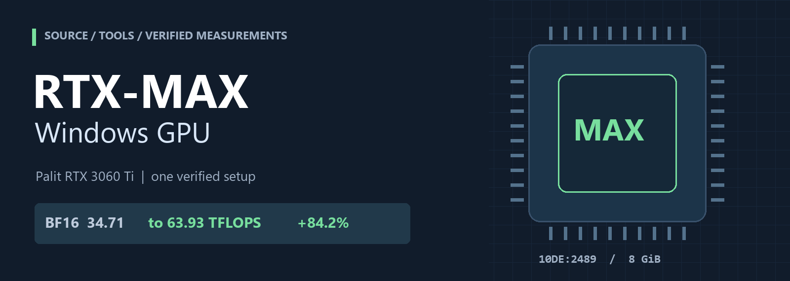
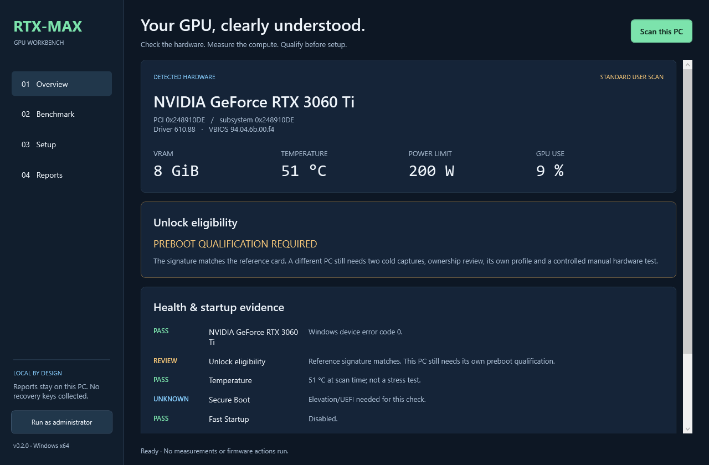
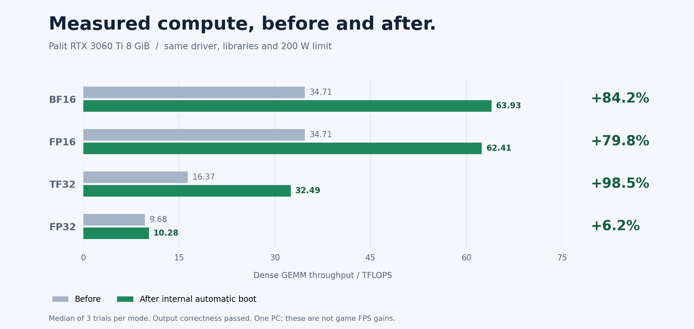
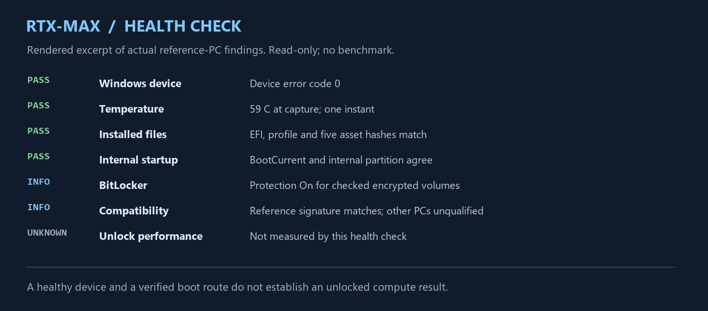

<p align="center"></p>

# RTX-MAX Windows GPU — الدليل العربي

[English](README.md) · [النتائج](RESULTS.md) · [التثبيت](docs/INSTALL.md) · [فحص الحالة](docs/HEALTH.md)

مشروع يوثّق تجربة فتح أداء الحسابات على **Palit RTX 3060 Ti**، مع المصدر ونتائج حقيقية وأداة فحص ملوّنة في Windows.

## تطبيق Windows بصيغة EXE

**[تحميل RTX-MAX.exe](https://github.com/Mustafa1p/RTX-MAX-Windows-GPU/releases/download/v0.2.0/RTX-MAX.exe)** — تطبيق محمول x64، لا يحتاج Python.

واجهة داكنة تضم حالة الكرت، اختبارات قبل وبعد مع التحقق من صحة الحسابات، إعدادًا موجّهًا وتجهيز ملفات محلية مُتحقّقًا منها، وتصدير التقارير. يمكن لمستخدمي RTX 20/30/40/50 فحص بيانات أجهزتهم؛ دعم الفتح يبقى مرتبطًا بتأهيل الجهاز الفعلي، وليس اسم الكرت فقط.



التطبيق يميّز «غير مدعوم بهذه النسخة» و«يحتاج تحققًا قبل الإقلاع» و«تثبيت سابق مُتحقّق منه». تنزيل مكتبات الحساب الاختيارية يتم من NVIDIA مع فحص البصمات، دون تغيير تعريف الشاشة. التطبيق يجهّز ملفات الإقلاع ويرشد للخطوات، ولا يفرمت أقراصًا أو يغيّر التشفير أو يعيد التشغيل تلقائيًا. تطبيق الفتح يحتاج مسار UEFI المؤهّل الموضح في الدليل.

[دليل التطبيق والمتطلبات](docs/DESKTOP.md) · [الإصدارات القابلة للتحميل](https://github.com/Mustafa1p/RTX-MAX-Windows-GPU/releases)

**التثبيت على الجهاز المرجعي مكتمل:** يعمل تلقائيًا من القرص الداخلي قبل Windows، دون الضغط على U. أُثبت مصدر الإقلاع الداخلي، مع بقاء الفلاشة موصولة وقت الاختبار؛ لم تُجرَ تجربة فصلها فعليًا.

> نجاح جهاز واحد لا يعني دعم كل كروت RTX أو حتى كل أجهزة 3060 Ti. يلزم ملف تعريفي وفحص توافق لكل جهاز. هذه نسخة مجتمعية تجريبية، وليست أداة رسمية من NVIDIA أو Palit.

## الإعداد: افحص الدعم قبل تطبيق الفتح

نزّل المشروع من **Code → Download ZIP** وفك الضغط، أو استخدم Git:

```powershell
git clone https://github.com/Mustafa1p/RTX-MAX-Windows-GPU.git
Set-Location RTX-MAX-Windows-GPU
.\Install-RTXMAX.ps1 -Action Check
```

إذا نزّلت ZIP، افتح PowerShell داخل المجلد وشغّل الأمر الأخير فقط. شغّل PowerShell كمسؤول لإتاحة فحوص الإقلاع والتشفير. هذا فحص فقط؛ لا يطبّق الفتح.

| السلسلة | دعم هذه النسخة |
| --- | --- |
| RTX 20 | غير مدعومة |
| RTX 30 | التحقق يخص جهاز Palit RTX 3060 Ti المرجعي فقط |
| RTX 40 | غير مدعومة |
| RTX 50 | غير مدعومة |

- ظهور **Reference GPU signature matches** يعني تطابق بيانات الكرت الأساسية والتعريف مع المرجع، لكن الجهاز يبقى مرشحًا يحتاج تحققًا من مسار العرض والملف التعريفي المحلي. لا يعني أن ملفات جهاز آخر أصبحت صالحة له.
- ظهور **outside the published reference test** يعني أن التثبيت غير مؤهّل. توقّف قبل تطبيق النسخة؛ لا تغيّر المعرّفات أو أعلام الموافقة لتجاوز الرفض.
- ظهور **UNKNOWN** يعني أن الفحص لم يُثبت الحالة، وليس أن الكرت مدعوم. عالج نقص الصلاحيات أو بيانات التعريف أولًا.
- ظهور **PASS** لصحة التعريف أو الحرارة لا يثبت فتح الأداء الحسابي.

**التطبيق بعد التأهيل المحلي فقط:** اتبع [التجربة اليدوية على USB](docs/INSTALL.md#option-2--manual-usb-experiment)، مع التقاطين باردين متطابقين، وملف تعريفي محلي مُراجع، وقياس قبل الفتح، وخطة استرجاع. لا تستخدم `PROFILE.BIN` أو معرّفات أقسام جهاز آخر.

بعد اكتمال هذه المتطلبات، ابنِ النسخة اليدوية وجهّز ملفاتك المحلية بالأوامر الموضحة في [خطوات الإعداد الإنجليزية](README.md#3-apply-only-after-local-qualification). خيار `Stage` يجهّز الملفات فقط. تطبيق الفتح نفسه يحدث عند إقلاع UEFI اليدوي والضغط على U وفق الدليل، ثم تُفحص صحة الحسابات واستعادة العرض وWindows والزيادة والثبات.

بعد نجاح التجربة اليدوية، يمكن تأهيل [الإقلاع الداخلي التلقائي](docs/INSTALL.md#option-3--internal-automatic-startup) بمعرّفات أقسام الجهاز نفسه. إذا كان التثبيت المؤهّل موجودًا أصلًا، لا تُعد تثبيته كل مرة؛ يُعاد تطبيق الفتح عند الإقلاع الكامل. تغييرات التعريف أو BIOS أو VBIOS أو مسار العرض تحتاج إعادة تحقق.

## النتائج المقاسة



| النمط | قبل، TFLOPS | بعد، TFLOPS | الزيادة |
| --- | ---: | ---: | ---: |
| BF16 | 34.71 | **63.93** | **+84.2%** |
| FP16 | 34.71 | 62.41 | +79.8% |
| TF32 | 16.37 | 32.49 | +98.5% |
| FP32 للمقارنة | 9.68 | 10.28 | +6.2% |

هذه سرعة حسابات ضرب المصفوفات، وليست FPS الألعاب. استُخدم نفس التعريف والمكتبات وحد الطاقة **200 واط**. نجح فحص صحة النتائج واختبار مختلط لمدة **602 ثانية**، وكانت أعلى حرارة مقاسة فيه **75°م**. لا يثبت هذا ثباتًا مثاليًا أو مدى الحياة.

## تشغيل الفحص

افتح PowerShell داخل مجلد المشروع وشغّل القائمة:

```powershell
.\RTX-MAX.ps1
```

أو شغّل الفحص مباشرة:

```powershell
.\Check-RTXMAX.ps1
```

تشغيل PowerShell كمسؤول يتيح قراءة إضافية لمسار الإقلاع والتشفير. لا يحتاج الفحص إلى Python. تظهر النتائج بالإنجليزية داخل الأداة لضمان وضوحها عبر إعدادات Windows المختلفة:

| الحالة | اللون | المعنى |
| --- | --- | --- |
| PASS | 🟢 أخضر | نجح هذا البند المحدد |
| WARN | 🟡 أصفر | يحتاج مراجعة |
| FAIL | 🔴 أحمر | رُصدت مشكلة في البند |
| INFO | 🔵 سماوي | معلومة عن الإعداد |
| UNKNOWN | رمادي | لم يُفحص أو تعذرت قراءته |

يفحص التعريف والحرارة وأخطاء الجهاز والسجلات وملفات التثبيت ومسار الإقلاع. يقرأ **حالة BitLocker فقط، دون مفاتيح الاسترداد**. يحفظ تقريرين JSON وMarkdown داخل `reports/`، ولا يغيّر إعدادات الجهاز أو يعيد تشغيله.

**ظهور PASS لا يثبت زيادة الأداء.** يجب مقارنة اختبار حسابات قبل وبعد، مع التحقق من صحة النتائج. تقرير الحرارة لقطة لحظية، وليس اختبار ضغط.



## خيارات التثبيت

1. **أدوات الفحص:** تعمل مباشرة دون تثبيت مكونات إقلاع.
2. **تجربة USB اليدوية:** بناء نسخة يدوية، وتجهيز ملفات محلية، ثم اختبار مدروس بالضغط على U.
3. **الإقلاع الداخلي التلقائي:** بعد نجاح التجربة اليدوية، تُجهّز نسخة مرتبطة بمعرّفات أقسام جهاز المستخدم نفسه.

سكربت `Install-RTXMAX.ps1` يبدأ بالفحص فقط. خيار `Stage` يجهّز الملفات في **مجلد جديد عادي**؛ لا يفرمت فلاشة أو يغيّر الأقسام أو BitLocker أو ترتيب الإقلاع. لا توجد هنا نسخة تنفيذية عامة تضمن دعم كل الأجهزة. اتبع [خطوات التثبيت](docs/INSTALL.md) و[الاسترجاع](docs/RECOVERY.md).

ملفّات firmware وPROFILE.BIN ونسخة AUTO.EFI الخاصة بجهازنا غير منشورة؛ يجب توليد الإعدادات والتحقق منها على الجهاز المستهدف. لا تنسخ معرّفات أقسام جهاز آخر.

## هل هذا كسر سرعة؟

لم نطبّق كسر سرعة أو تفليش VBIOS في التجربة المرجعية. التعديل يفتح قيود أداء حسابات Tensor ويُعاد تطبيقه عند الإقلاع الكامل. السكون والإسبات والاستئناف وإعادة ضبط التعريف والألعاب لم تُختبر ضمن هذا التحقق.

## التحقق من الأرقام المنشورة

يتطلب Python 3.10 أو أحدث:

```powershell
python tools/verify_results.py
python -m unittest discover -s tests -v
python tools/check_package.py
```

البيانات الخام والمصدر الذي أنتجها موجودان في `results/`. إعادة حساب الأرقام لا تعني إجراء اختبار جديد على كرت المستخدم.

المصدر مشتق من المشاريع المذكورة في [صفحة الاعتمادات](THIRD_PARTY_NOTICES.md)، مع الحفاظ على التراخيص. انظر [دليل الرفع إلى GitHub](docs/PUBLISHING.md). لا ترفع مفاتيح BitLocker أو تقارير محلية غير مراجعة.
