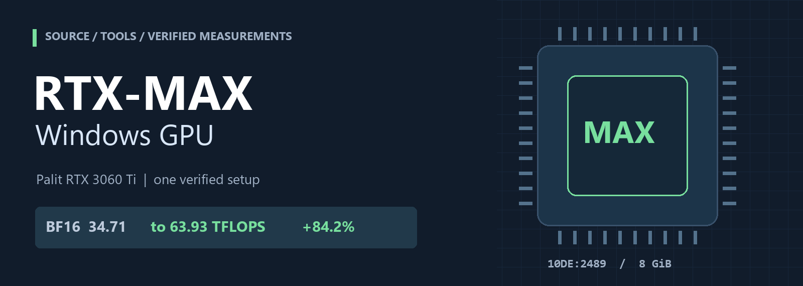
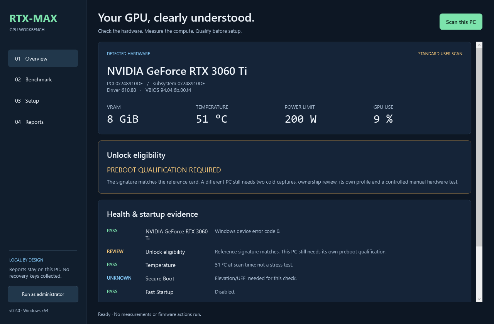
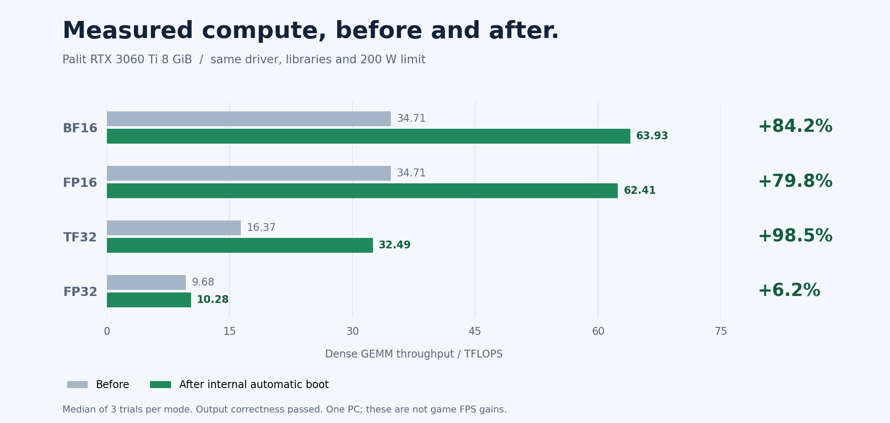
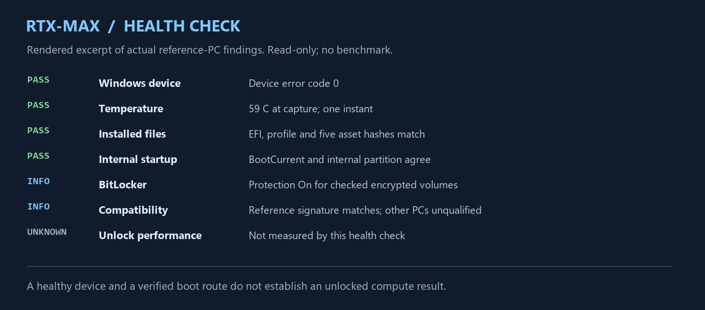
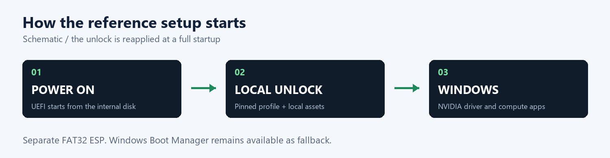

<p align="center"></p>

# RTX-MAX Windows GPU

**A documented Palit RTX 3060 Ti UEFI unlock experiment, with real before/after measurements and read-only Windows health checks.**

[العربية](README.ar.md) · [Results](RESULTS.md) · [Installation options](docs/INSTALL.md) · [Health checks](docs/HEALTH.md) · [Build from source](docs/BUILD.md)

## Windows desktop app

**[Download RTX-MAX.exe](https://github.com/Mustafa1p/RTX-MAX-Windows-GPU/releases/download/v0.2.0/RTX-MAX.exe)** — portable Windows x64, no Python required.

The desktop workbench combines GPU/health and unlock-eligibility checks, native correctness-checked CUDA before/after measurements, guided setup with local file validation/preparation, and local report exports. Its status distinguishes unsupported hardware, a candidate needing preboot review and a verified existing installation. Other RTX generations can be inspected without being approved for this firmware port.



[Desktop guide and requirements →](docs/DESKTOP.md) · [Download releases →](https://github.com/Mustafa1p/RTX-MAX-Windows-GPU/releases)

Firmware application still follows the qualified preboot procedure. The app does not turn a name match into universal support or silently modify disks/encryption/startup.

| Reference installation | BF16 gain | Mixed-load check | Public package |
| --- | --- | --- | --- |
| 🟢 Internal automatic boot verified | **+84.2% measured** | 602 seconds / correctness passed | Source, tools, documentation, evidence |

> **Support scope:** one verified Palit RTX 3060 Ti system. A matching GPU name or PCI ID does not qualify another PC. This is an experimental community port, with no NVIDIA or Palit endorsement. There is no universal one-click unlock installer in this repository.

## Setup: check support before applying

### 1. Download and check your GPU

Clone the repository, or use **Code → Download ZIP** and extract it. Open PowerShell in the extracted project folder:

```powershell
git clone https://github.com/Mustafa1p/RTX-MAX-Windows-GPU.git
Set-Location RTX-MAX-Windows-GPU
.\Install-RTXMAX.ps1 -Action Check
```

The first two commands are only needed when cloning with Git. Run PowerShell **as administrator** for complete boot/encryption checks. The check needs the installed NVIDIA driver and its `nvidia-smi` tool; it does not need Python and does not apply the unlock.

### 2. Read the support result

| GPU family | This port's support | Next step |
| --- | --- | --- |
| RTX 20 | Unsupported | Do not apply this port |
| RTX 30 | One Palit RTX 3060 Ti reference PC verified | Compare the exact signature, then qualify your own PC |
| RTX 40 | Unsupported | Do not apply this port |
| RTX 50 | Unsupported | Do not apply this port |

- **`Compatibility: Reference GPU signature matches`** means the model, PCI/subsystem IDs, VBIOS, driver, memory size and power limit match the published reference. It is a **candidate match**, not permission to apply the reference PC's files. Display topology and a local runtime profile still need verification.
- **`Compatibility: ... outside the published reference test`** means this installation is unqualified. Stop before applying the port; do not force it or edit IDs/approval flags to bypass a refusal.
- **`UNKNOWN`** means a check could not establish its result. Resolve missing permissions/telemetry first; unknown is not supported.
- Green device, temperature and boot checks report those individual checks only. They do not prove unlocked Tensor performance or qualify another PC.

The exact reference signature and qualification requirements are in [COMPATIBILITY.md](docs/COMPATIBILITY.md). The repository does not provide a Windows-only test that can certify all preboot hardware conditions.

### 3. Apply only after local qualification

For a new PC, first follow [the manual USB qualification procedure](docs/INSTALL.md#option-2--manual-usb-experiment): two matching cold probe captures, a reviewed local profile/display route, a stock correctness-checked benchmark and a recovery plan. **Do not use another PC's PROFILE.BIN or partition GUIDs.**

Once those prerequisites are verified, build the manual port using your installed LLVM/C++ build tools:

```powershell
.\tools\Build-Firmware.ps1 -Mode Manual `
    -LlvmBin C:\Tools\LLVM\bin `
    -OutputDirectory .\build\manual-local
```

Then stage your own reviewed profile and locally extracted firmware assets. Replace the example paths with your actual local paths; the destination parent must exist and the destination folder must be new:

```powershell
.\Install-RTXMAX.ps1 -Action Stage `
    -BuildDirectory .\build\manual-local `
    -ProfilePath C:\LocalEvidence\PROFILE.BIN `
    -AssetsDirectory C:\LocalAssets\firmware-assets `
    -Destination C:\LocalPackages\rtxmax-manual
```

`Stage` prepares files only; it does not apply the unlock or change the boot configuration. Complete the [documented USB boot and manual U step](docs/INSTALL.md#option-2--manual-usb-experiment), then check restoration/Windows handoff, compute correctness, measured gains and stability. Only after that succeeds should you follow [internal automatic startup](docs/INSTALL.md#option-3--internal-automatic-startup), using the destination PC's own partition identities.

If your qualified internal installation is already present, check it with `Check-RTXMAX.ps1`; it reapplies the unlock during full startup. There is no need to reinstall it on each Windows session. A changed driver, VBIOS, BIOS or display route requires requalification.

## Measured results



| Compute mode | Before, TFLOPS | After, TFLOPS | Change |
| --- | ---: | ---: | ---: |
| BF16, FP32 accumulation | 34.71 | **63.93** | **+84.2%** |
| FP16, FP32 accumulation | 34.71 | 62.41 | +79.8% |
| TF32, FP32 accumulation | 16.37 | 32.49 | +98.5% |
| FP32 control | 9.68 | 10.28 | +6.2% |

These are dense GEMM compute measurements, not game FPS. Three trials per mode used 4096 × 4096 matrices, 30 CUDA-event samples and a two-second warmup. All output elements were checked, with additional seeded nonconstant matrices checked against an independent CPU reference. Driver, libraries, GPU identity and 200 W power limit matched. Desktop activity and actual clocks varied between sessions. [Full methodology and limitations →](RESULTS.md)

## Start with a health check

Requirements: Windows 11/Windows PowerShell 5.1 or PowerShell 7; an installed NVIDIA driver providing `nvidia-smi`. Administrator mode enables additional firmware and encryption checks. No Python is needed for the health check.

Download/extract the repository, open PowerShell in this folder, and run:

```powershell
.\RTX-MAX.ps1
```

Or run the check directly:

```powershell
.\Check-RTXMAX.ps1
```

If your local script policy blocks a file you have reviewed, a process-only invocation is:

```powershell
powershell.exe -NoProfile -ExecutionPolicy Bypass -File .\Check-RTXMAX.ps1
```

The checker reads device errors, temperature, driver/VBIOS identity, recent relevant events, Secure Boot/Fast Startup status, BitLocker **status only**, installed artifact hashes and actual UEFI boot evidence when accessible. It writes JSON and Markdown under `reports/`. It does not unlock the GPU, change startup or run a load test. **A green device/boot check does not prove an unlocked compute state.** [Interpret the report →](docs/HEALTH.md)



## Installation options

| Option | What it does | Availability |
| --- | --- | --- |
| Health tools | Run the PowerShell checks; no boot installation | Included |
| Manual USB experiment | Local profile + assets + manual EFI; press U for the test | Source/build and staging tool included; hardware qualification required |
| Internal automatic startup | Apply the unlock before Windows at each full startup | Verified on the reference PC; each destination needs its own reviewed profile and partition identities |

`Install-RTXMAX.ps1` defaults to a **read-only check**. Its `Stage` action prepares a **new ordinary folder** from locally supplied inputs. It does not format a USB, repartition a disk, change encryption or register boot entries. Follow [INSTALL.md](docs/INSTALL.md) for the full sequence and [RECOVERY.md](docs/RECOVERY.md) for returning to Windows first.



The reference setup uses a separate 1 GiB FAT32 EFI system partition, with the unlock entry first and Windows Boot Manager as fallback. Secure Boot and Fast Startup are disabled; C: and D: BitLocker protection was restored and verified on. The reference test USB remained connected, but native BootCurrent and internal artifact checks established the internal boot source. Physical USB removal was not tested.

## What is actually supported?

The tested combination is **Palit RTX 3060 Ti / 8 GiB / PCI `10de:2489` / subsystem `10de:2489` / VBIOS `94.04.6b.00.f4` / driver `610.88`**, on ASRock B550M-HDV BIOS P3.40 with Ryzen 5 3600 and Windows 11 build 26300. [Compatibility matrix →](docs/COMPATIBILITY.md)

The unlock changes compute restrictions; no overclock or VBIOS flash was applied in the reference experiment. It is reapplied during startup. Sleep, hibernate, resume, driver resets, future firmware/driver changes and application speedups are not qualified. The finite tests do not establish perfect or lifetime stability.

## Inspect or reproduce the evidence

Python 3.10+ is required for these commands; no CUDA libraries are needed to verify archived results.

```powershell
python tools/verify_results.py
python -m unittest discover -s tests -v
powershell.exe -NoProfile -File tools/Test-BootParser.ps1
python tools/check_package.py
```

Raw baseline/after timings, the mixed-load record, the exact measurement source and a sanitized session summary are in [`results/`](results/README.md). The verification tool recomputes the table; it does not test the current GPU. See [BUILD.md](docs/BUILD.md) to compile the firmware source.

## Project layout

```text
RTX-MAX.ps1           Colored command menu
Check-RTXMAX.ps1      Read-only health and installed-file checks
Install-RTXMAX.ps1    Check or stage local installation inputs
README.ar.md         Arabic guide
RESULTS.md           Measurement details and limits
assets/              Original repository artwork and measured charts
docs/                Installation, build, compatibility, health and recovery
firmware/            Attributed upstream source + local Palit port
results/             Allowlisted public measurements and provenance
tools/               Build, validation and publication checks
tests/               Integrity and rejection-path tests
desktop/             Native WPF EXE, CUDA engine and guided setup source
```

## Credits and license

The original requested project was [impacifist/Windows-GPU-UNLOCK](https://github.com/impacifist/Windows-GPU-UNLOCK). This tested port is based on [craftingmod/rtx30-unlock](https://github.com/craftingmod/rtx30-unlock) at `5c076dc4ee7fa369639669fa591ac74d8f6dfcd8`, with original core work from [Zagitta/gpu-unlock](https://github.com/Zagitta/gpu-unlock) and the projects credited in [THIRD_PARTY_NOTICES.md](THIRD_PARTY_NOTICES.md). This is a local downstream port, not an upstream support announcement.

GPL-2.0-only applies to the project code; component notices and other licenses are retained. NVIDIA firmware is **not included** and is not relicensed by this repository. See [LICENSE](LICENSE), [UPSTREAM-NOTICES.md](UPSTREAM-NOTICES.md) and [firmware provenance/distribution scope](firmware/tools/firmware/NOTICE.md).

Want to publish this folder? Follow the short [GitHub checklist](docs/PUBLISHING.md). No recovery keys, GPU ROM dumps, machine partition IDs or ready-to-boot payloads belong in a public commit.
