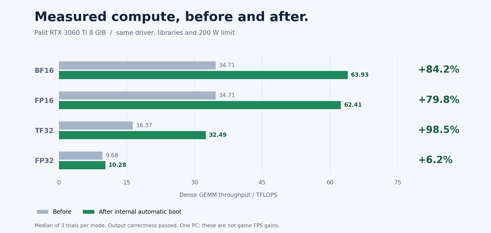

# Verified results — Palit RTX 3060 Ti

Reference hardware testing completed **30 October 2026, Asia/Baghdad**. These are first-party measurements from one PC, not independent certification or a support claim for all cards.



| Mode | Before, TFLOPS | Internal automatic boot, TFLOPS | Change |
| --- | ---: | ---: | ---: |
| BF16, FP32 accumulation | 34.71298 | 63.92843 | +84.1629% |
| FP16, FP32 accumulation | 34.71298 | 62.41460 | +79.8019% |
| TF32, FP32 accumulation | 16.36711 | 32.48742 | +98.4921% |
| FP32 pedantic control | 9.67660 | 10.27671 | +6.2017% |

## Setup and comparison

Palit RTX 3060 Ti, 8 GiB, PCI/subsystem `10de:2489` / `10de:2489`, VBIOS `94.04.6b.00.f4`, NVIDIA driver 610.88. ASRock B550M-HDV BIOS P3.40, Ryzen 5 3600, Windows 11 Pro build 26300. No GPU overclock, VBIOS flash or power-limit increase was applied; the limit stayed 200 W.

The measurement runner used CUDA runtime 12.6.37 and cuBLAS 12.6.0.22. Source, DLL hashes, library versions, GPU identity, driver, VBIOS and power limit matched across the reported sessions. Actual SM clocks, temperature and background desktop activity varied. The measured FP32 difference is included as context, not proof that every observed change is caused solely by the unlock.

Each mode used three trials, each with a 4096 × 4096 GEMM, a two-second warmup and 30 CUDA-event timing samples. Each trial reports its sample median; the table reports the median of three trial TFLOPS values. FLOP count is `2 × N³`. This is dense arithmetic throughput, not sparsity throughput or game FPS.

Every element of the all-ones output was verified. Additional seeded 256 × 256 nonconstant matrices were checked against an independent CPU calculation in all four modes. Every measured Tensor-mode after-trial exceeded every corresponding before-trial in these recordings.

## Boot and load verification

Three unlocked Windows sessions were observed: manual USB, internal automatic with logging, and default internal automatic quiet startup. The final reported compute session followed the quiet internal boot. Actual UEFI BootCurrent, loader path, partition identity and local artifact hashes established that boot route.

**The USB remained physically connected.** Internal startup and asset independence were verified directly; physical USB absence was not tested. The tool is reapplied at full startup, not permanently flashed into VBIOS.

A separate mixed-load check in the preceding unlocked session ran for **602.282 seconds**, completed **88 cycles**, and checked **4,602,200,064 output elements**. It mixed large Tensor GEMMs and seeded 256/512/768/1024 calculations. Highest sampled temperature was **75°C**; correctness passed. The final session's relevant device/WHEA/BugCheck event scan returned no matching errors.

At final verification, Secure Boot and Fast Startup were disabled, C: and D: remained fully encrypted, and their BitLocker protection was on. No encryption keys or machine partition GUIDs are part of the published evidence.

## Verify the archived evidence

```powershell
python tools/verify_results.py
```

The script recomputes trial medians/gains, checks timing-derived TFLOPS, checks full-output and nonconstant correctness flags, matches source/library/settings evidence and verifies the mixed-load summary. It is not a live GPU test and cannot independently authenticate first-party captures.

| Evidence | File |
| --- | --- |
| Raw baseline | [Baseline JSON](results/raw/cuda-baseline-2026-10-30.json) |
| Raw final after-session | [After JSON](results/raw/cuda-internal-default-quiet-after-2026-10-30.json) |
| Mixed-load record | [Stability JSON](results/raw/cuda-unlocked-stability-10min-2026-10-30.json) |
| Sanitized hardware/session summary | [Verified session](results/verified-session.json) |
| Reference artifact hashes | [Reference artifacts](results/reference-artifacts.json) |
| Exact measurement scripts | [Measurement source](results/measurement-source) |

The raw runner's `unlock_attempted: false` and `ordinary_cuda_baseline_not_unlock_validation` fields describe the measurement program: it performs ordinary CUDA work and does not apply an unlock. External preboot evidence establishes the unlocked after-session. The raw data has not been rewritten to relabel that field.

The archived measurement source expects its original local CUDA directory layout and the original PCI bus address. It is retained unchanged to preserve its recorded hash. Re-running it elsewhere needs separately documented dependency setup/porting; do not call edited runs an identical binary/source comparison.

## Limits

One hardware setup and finite test durations. No assurance of lifetime/perfect stability. Other GPUs, identical cards in different PCs, sleep/hibernate/resume, driver reset/TDR, future driver/BIOS/VBIOS changes, games and application speedups are unqualified. A new source build has `hardware_tested: false` until tested; the published result must not be copied as approval for that new artifact.
