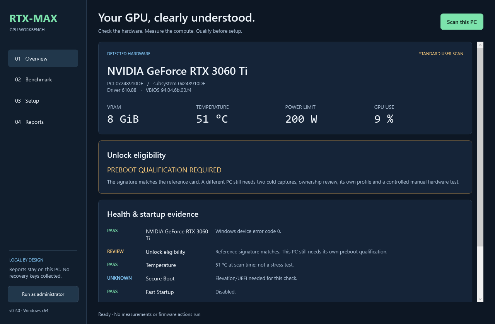
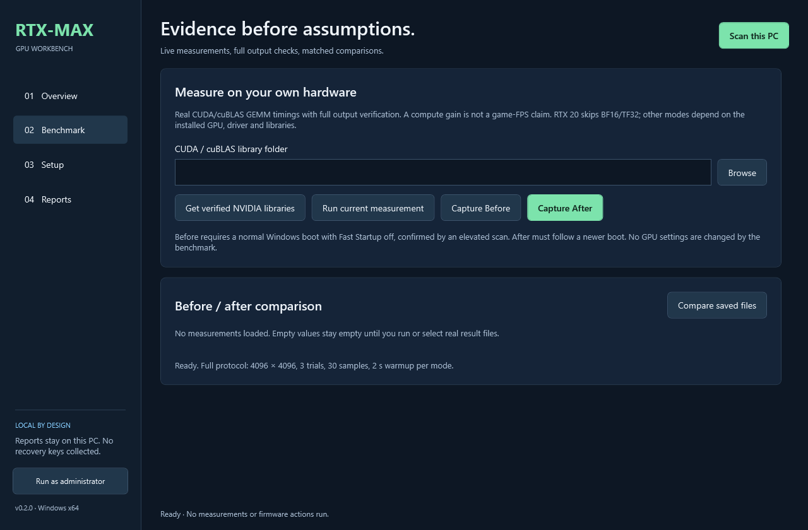

# RTX-MAX desktop EXE

[Download RTX-MAX.exe](https://github.com/Mustafa1p/RTX-MAX-Windows-GPU/releases/download/v0.2.0/RTX-MAX.exe) · [Source](../desktop) · [Setup procedure](INSTALL.md)

A portable Windows x64 application with four pages: Overview, Benchmark, Setup and Reports. No Python, Git or separate .NET 8 desktop runtime is required to run it. It targets .NET Framework 4.7.2 or newer, included in Windows 11 and current Windows 10 installations. The executable contains the matching GPL source and guides. NVIDIA firmware and CUDA DLLs are not bundled.

## 1. Scan the GPU

Open the EXE and select **Scan this PC**. It reads device errors, GPU identity, driver/VBIOS, temperature, memory, power limit, startup configuration, relevant current-boot events and known installed artifacts. **Run as administrator** relaunches only when you request it, enabling additional boot/encryption checks.

| Result | Meaning |
| --- | --- |
| Detection incomplete | Missing driver/permissions/telemetry; not a support approval |
| Unsupported by this unlock port | The GPU can still be inspected or benchmarked if its CUDA stack supports it; firmware preparation is blocked |
| Preboot qualification required | The reference signature matches, but this PC still needs cold captures, ownership review and its own profile |
| Verified existing installation | Actual internal boot route and known artifact hashes agree with the reference installation on this PC; current performance has not been measured by the scan |

RTX 20/30/40/50 owners can inspect hardware. That does **not** qualify all generations for the unlock. This release's firmware port remains limited to its documented Palit 2489 reference configuration.



## 2. Measure current, Before and After

Select a local CUDA/cuBLAS library folder or choose **Get verified NVIDIA libraries**. The download uses pinned CUDA 12.8.1 redistributable packages from NVIDIA, checks their archive sizes and SHA-256 hashes and preserves their license files. It downloads approximately 541 MiB and may need several GiB of free disk space for archives/extraction. It does not install or replace the NVIDIA display driver. Newer GPUs need a compatible driver/library combination; a runtime refusal is not bypassed.

- **Run current measurement:** measures this session without labeling it stock or unlocked.
- **Capture Before:** requires an elevated check observing normal Windows Boot Manager and Fast Startup disabled. Perform the documented full shutdown/cold startup in the stock configuration first. Boot-path evidence alone does not prove the GPU is stock after every possible warm reset/resume.
- **Capture After:** use after the controlled, qualified UEFI attempt and a newer Windows boot.
- **Compare saved files:** select native Before and After JSON files. The tool refuses mismatched device keys, driver/VBIOS, PCI bus, power limit, engine hash, CUDA/cuBLAS versions/hashes, workload, missing correctness evidence or the same Windows boot.

The native protocol uses 4096 × 4096 dense GEMM, three trials, 30 CUDA-event samples and a two-second warmup for each supported mode. Every large-output element is checked. A separate seeded 128 × 128 matrix is compared against an independent CPU calculation for each mode. RTX 20 skips BF16/TF32; other modes depend on what the actual GPU/driver/libraries execute correctly. Idle and 85°C temperature guards can stop a measurement. Stopped/partial/smoke runs are never accepted as full comparisons.

The desktop native protocol is **different from the archived Python reference protocol**. It does not mix those report formats or claim the native results are an identical reproduction of the published reference table. A measured compute gain is not a game-FPS claim or independent proof that an unlock caused all of the change.



## 3. Guided setup and local preparation

The Setup page contains the full embedded setup procedure, source extraction and native package validation/preparation. No Python is needed for that preparation step.

1. Scan, establish a stock baseline, save the recovery key privately and complete the documented local probe/profile ownership review.
2. Use **Extract source & setup tools** to obtain the matching source. Firmware compilation still needs LLVM and C++/Windows SDK build tools, as described in [BUILD.md](BUILD.md). The app does not fabricate approval or a profile.
3. Select the local build directory, reviewed PROFILE.BIN, five pinned firmware assets plus NVIDIA-LICENSE and a new ordinary output folder. Confirm that the evidence belongs to this PC and was reviewed.
4. **Validate & prepare package** verifies target/profile checksum, EFI format/import restrictions/build hash and pinned asset sizes/hashes. It copies files/licenses and writes a staging manifest. The firmware step is blocked for other GPU signatures; an internal rebuild also requires the already verified local internal boot identities.
5. Follow the embedded spare FAT32 USB/manual U boot sequence, return to Windows, capture After and check correctness, gain and stability. Internal automatic boot requires the separate target-specific procedure and boot-source verification.

This is a guided setup/preparation workflow, **not a universal one-click firmware installer**. It does not format/repartition drives, collect recovery keys, modify BitLocker/Secure Boot, register boot entries or reboot. File preparation is not a replacement for the hardware qualification/boot steps. Already verified internal installations reapply the unlock at full startup.

## 4. Local reports

Reports and settings are stored under `%LOCALAPPDATA%\RTX-MAX`. Nothing is uploaded automatically. The normal saved health record can include partition identifiers; **Export redacted health JSON** omits partition/device-key details. Exported comparisons contain matched compute rows. Review any manually shared raw report.

## Build and development checks

From the source repository on Windows, with Visual Studio Roslyn and .NET Framework 4.7.2 reference assemblies installed:

```powershell
.\tools\Build-Desktop.ps1 -OutputDirectory .\build\desktop-local
```

The output is `RTX-MAX.exe` and a SHA-256 build manifest. Matching source is embedded in the executable. The wrapper runs native backend self-tests by default; they use synthetic data and never touch the GPU/boot configuration. Build outputs stay outside Git.

```powershell
Start-Process .\build\desktop-local\RTX-MAX.exe -ArgumentList '--self-test' -Wait
```

The release is unsigned; no NVIDIA/Microsoft signing or hardware certification is claimed. Source and hashes are available for review. See the release's validation notes for which actual hardware tests were completed and which were blocked by background GPU activity.
